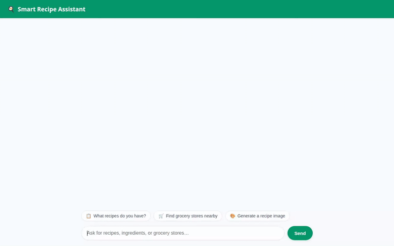

# 🍳 Smart Recipe Assistant

A personalized, multimodal AI culinary assistant built with Google's **Agent Development Kit (ADK)** and deployed on **Agent Runtime**. The assistant manages custom recipes in Firestore, remembers dietary preferences across sessions via Vertex AI Memory Bank, locates specialty grocery stores using Google Maps APIs, generates dish images and videos, and presents rich UI cards using **A2UI**.



---

## 🌟 Implemented Features & Google Cloud Services

### 🧠 Cross-Session Memory
- **Vertex AI Memory Bank**: Automatically extracts and persists user dietary preferences, allergies, and favorite cuisines across sessions, seamlessly personalizing recipe recommendations.

### 📚 Recipe Database & External Retrieval
- **Google Cloud Firestore**: Queries, adds, and updates custom user recipes and ingredients in a NoSQL Firestore database.
- **TheMealDB API**: Integrates real-world culinary ideas and international recipes via external REST API calls.

### 🎨 Multimodal Media Generation & Storage
- **AI Dish Image Generation**: Uses `gemini-3.1-flash-lite-image` (global region) to generate food images.
- **AI Dish Video Generation**: Uses `gemini-omni-flash-preview` (global region) to generate culinary videos.
- **Google Cloud Storage**: Stores generated image and video assets in a public Cloud Storage bucket and returns public URLs.

### 🛒 Local Market & Grocery Search
- **Google Maps Geocoding & Places APIs**: Converts location addresses into coordinates and searches for nearby specialty markets, supermarkets, and grocery stores.

### 💻 Code Sandbox Execution
- **Python Code Executor**: Safely executes Python code in a sandboxed environment for dynamic recipe scaling and nutritional math calculations.

### 🖼️ Rich A2UI Interface
- **Agent-Side A2UI Extension**: Emits structured UI components (Cards, Columns, Rows, Texts, Images) for a visual interface experience.

---

## 🏗️ Architecture Overview

```
               +-----------------------------------+
               |  Custom Web Frontend (FastAPI)    |
               |  Plain HTML/CSS/JS + A2UI         |
               +-----------------+-----------------+
                                 | A2A Protocol
                                 v
               +-----------------------------------+
               |  Smart Recipe Assistant (ADK)     |
               |  Gemini 2.5 Flash Root Agent      |
               +-----------------+-----------------+
                                 |
         +-----------------------+-----------------------+
         |                       |                       |
         v                       v                       v
+-----------------+     +-----------------+     +-----------------+
| Vertex AI       |     | Cloud Firestore |     | Cloud Storage   |
| Memory Bank     |     | Recipe Database |     | Media Assets    |
+-----------------+     +-----------------+     +-----------------+
         |                       |                       |
         v                       v                       v
+-----------------+     +-----------------+     +-----------------+
| Google Maps     |     | Vertex AI GenAI |     | Python Code     |
| Places API      |     | Image & Video   |     | Sandbox         |
+-----------------+     +-----------------+     +-----------------+
```

---

## 🚀 Local Setup & Running Instructions

### 1. Prerequisites
- Python 3.10+ and [`uv`](https://github.com/astral-sh/uv) package manager.
- Google Cloud SDK (`gcloud`) authenticated to a GCP project with Vertex AI, Firestore, and Cloud Storage enabled.
- Node.js 18+ (for frontend recording scripts or local web tools).

### 2. Environment Variables
Copy `.env.example` to `.env` and configure your GCP Project ID and Google Maps API Key:
```bash
cp .env.example .env
```

Ensure `.env` contains:
```env
GOOGLE_CLOUD_PROJECT=your-gcp-project-id
GOOGLE_MAPS_API_KEY=your-google-maps-api-key
```

### 3. Run the Agent Locally (ADK Web / Dev UI)
To test and interact with the agent using the ADK Development UI:
```bash
uv run adk web
```
Open the local developer interface in your browser at port 8000.

### 4. Run the Custom FastAPI Frontend Locally
To run the lightweight FastAPI proxy and chat interface locally:
```bash
cd frontend
uv run python main.py
```
Open the web application in your browser at port 8080.

---

## 🛠️ Project Structure

```
smart-recipe-assistant/
├── app/                        # ADK Agent definition and tools
│   ├── agent.py                # Main root_agent, tools, callbacks, and prompt
│   ├── a2ui_utils.py           # A2UI card renderer helper utilities
│   └── __init__.py
├── frontend/                   # Custom web frontend
│   ├── main.py                 # FastAPI proxy converting requests to A2A protocol
│   └── static/
│       └── index.html          # HTML/CSS/JS frontend with A2UI renderer
├── agents-cli-manifest.yaml    # Agent Platform deployment metadata
├── demo.gif                    # Loop demo recording showing database & image generation
├── pyproject.toml              # Dependencies and project configuration
└── README.md                   # Project documentation
```
